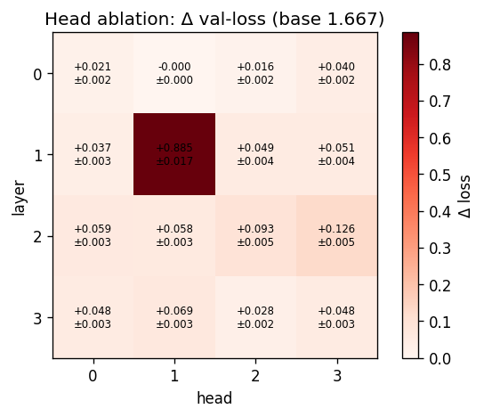
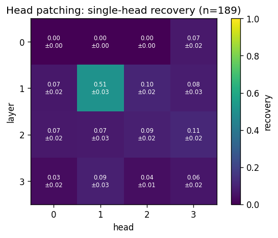
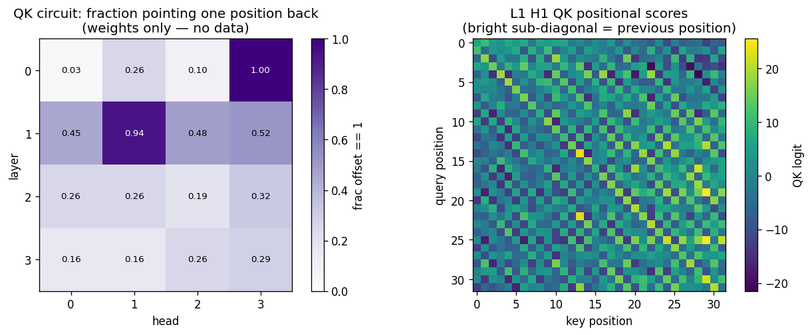

# gpt


A character-level GPT trained on Tiny Shakespeare, built so that every attention head can be inspected, ablated and patched. It follows Karpathy's "Let's build GPT" and adds the tooling to find out which parts of the trained model do the work.

This is the third repo in a series: [micrograd](https://github.com/diego-magana/micrograd) (scalar autograd), [makemore](https://github.com/diego-magana/makemore) (bigram to WaveNet), then this one.

## Result

The model has 4 layers and 4 heads per layer. One head, layer 1 head 1 (L1 H1), carries most of the next-character prediction by moving the previous character into the position that predicts the next one.

A second head, L0 H3, has nearly the same attention pattern and the same positional circuit in its weights, but removing it costs almost nothing. Attention maps alone would not separate the two. Ablation does.

Across five training seeds the same kind of head always appears in layer 0 or 1. Its index changes from seed to seed.



## Findings

All numbers come from the 30,000-step checkpoint in `assets/gpt.pth`.

| Analysis | Result |
|---|---|
| Attention patterns, 512 held-out sequences | L1 H1 puts 0.98 of its attention on the previous token. L0 H3 puts 0.82. |
| Head ablation | Zeroing L1 H1 raises validation loss by 0.89 ± 0.02 nats, 7x any other head. Zeroing L0 H3 raises it by 0.04. |
| Pairwise ablation | With L1 H1 already removed, zeroing L0 H3 costs 0.23 instead of 0.04. L0 H3 is a backup, not dead weight. |
| Residual patching | Block 1 moves the corrupted character's information forward. Recovery goes from 0.24 at the corrupted position to 0.74 at the prediction position. |
| Head patching | Restoring L1 H1's clean output alone recovers 0.51 ± 0.03 of the prediction, 5x the next head. |
| QK circuit, weights only | L1 H1 points exactly one position back for 94% of query positions. L0 H3 does so for 100%. No other head exceeds 0.52. |
| OV circuit, weights only | L1 H1 does not copy tokens straight to the output (top-1 agreement 0.02). The map is full rank, so the token identity is written to a subspace that layers 2 and 3 decode. |
| Corruption distance sweep | The flip rate falls from 0.73 one position back to 0.19 five positions back. L1 H1 stays the top head through distance 3. |
| Logit lens | Top-1 accuracy by depth: 0.06, 0.12, 0.21, 0.34, 0.51. |
| Seed sweep, 5 seeds at 3,000 steps | The most important head is always a previous-token head in layer 0 or 1 (previous-token attention 0.90 to 0.97). Which head it is varies. |

The OV result explains why head patching recovers 0.51 and not 1.0. L1 H1 fetches the character, and the later layers turn it into a prediction.





The full analysis, with the remaining figures and the method for each step, is in [`notebooks/05_attention_analysis.ipynb`](notebooks/05_attention_analysis.ipynb).

## Limits

- This is one mechanism in a small model. With `block_size=32` and 0.21M parameters there is no room for longer-range behavior such as induction heads.
- I have not run path patching, so the downstream path that decodes L1 H1's output is inferred from the OV result, not measured.
- The seed sweep uses a 3,000-step budget, shorter than the 30,000-step checkpoint.

## Model progression

Each stage adds one component. The three transformer stages share a 5,000-step budget so the comparison is about architecture, not training length.

| Stage | Params | Steps | Val loss (nats) |
|---|---:|---:|---:|
| Bigram baseline | 4,225 | 20,000 | 2.474 |
| + single attention head | 22,721 | 5,000 | 2.356 |
| + multi-head + feed-forward | 59,969 | 5,000 | 1.985 |
| Full GPT (4 blocks, residual + LayerNorm) | 209,729 | 5,000 | 1.798 |

The analyzed checkpoint is the full architecture trained for 30,000 steps (val loss about 1.65). The bigram is trained to its plateau because it has a fixed floor. All runs use seed 1337, batch size 16, learning rate 1e-3 and AdamW. Validation loss is mean cross-entropy on held-out text.

## Run it

```bash
pip install -e .
python train_gpt.py             # rebuild assets/gpt.pth, about 15 min on CPU
python seed_sweep.py --seed 0   # one row of the seed sweep
jupyter lab notebooks/          # progression first, then 05_attention_analysis
```

```bash
pytest                  # 18 tests
pytest -m "not slow"    # 10 fast tests, skips the ones that train a model
```

`assets/gpt.pth` is committed so the analysis notebook runs without retraining. CI runs the tests and executes the analysis notebooks against that checkpoint.

## Layout

```
gpt/
├── gpt/
│   ├── data.py        char tokenizer, train/val split, batching
│   ├── layers.py      Head, MultiHeadAttention, FeedForward, Block, ActivationCache
│   ├── train.py       training loop, evaluation, generation, seeding
│   └── analysis.py    attention stats, ablation, patching, QK/OV, logit lens
├── models/
│   ├── bigram.py
│   └── gpt.py         GPT, GPTConfig, instrumented forward, checkpointing
├── notebooks/
│   ├── 05_attention_analysis.ipynb
│   └── progression/   01 bigram, 02 single head, 03 multi-head + FFN, 04 full GPT
├── assets/            checkpoint, loss history, seed sweep results, figures
├── data/              input.txt (Tiny Shakespeare)
├── tests/             test_smoke.py (fast), test_analysis.py (slow)
├── train_gpt.py
└── seed_sweep.py
```

## Engineering notes

- Blocks are stored in a `ModuleList` and looped over explicitly. `nn.Sequential` would hide the per-layer access that caching, ablation and patching need.
- Patches are written into a cloned tensor, so a corrupted run cannot overwrite the cached clean activations. Two unit tests check that patching a run with its own activations changes nothing, for both residual and head patching.
- Patching is scored by the logit difference between the clean and corrupted targets, on the 189 of 256 examples where the corruption flipped the top prediction.
- Ablation error bars are the standard error of the paired per-batch difference. Patching error bars are the standard error across examples.
- Evaluation uses its own seeded generator. In the original code training and evaluation share one generator, so the trained weights depend on how often you evaluate.
- Checkpoints store the `GPTConfig` with the weights, and `from_pretrained` rebuilds the matching architecture.
- Attention is scaled by `1/sqrt(head_size)`. Scaling by `1/sqrt(n_embd)` does not crash, but it makes the softmax too sharp at initialization and training stalls.

## Attribution

The architecture and training recipe follow Andrej Karpathy's "Let's build GPT: from scratch, in code, spelled out" and [nanoGPT](https://github.com/karpathy/nanoGPT). The interpretability tooling, the reproducibility work and the analysis are mine.
